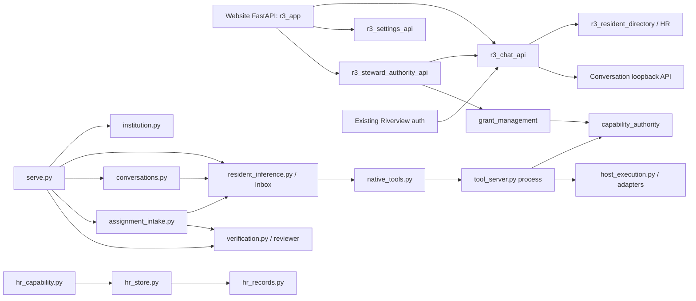

<!--
R3 CONTROLLED DOCUMENT
File: docs/architecture/R3_MODULAR_ARCHITECTURE_AUDIT_2026-11-05.md
Component: R3-ARCHITECTURE-AUDIT
File Revision: 1.0.0
Created: 2026-11-06T00:26:26Z
Created By: Codex GPT-6
Purpose: Evidence-based contingency audit and incremental modularization recommendation for R/3.
Execution Model: Read-only source, Git, service, process, HTTP-health, and database-metadata inspection; documentation only.
Observability: Source commit references, captured process/service responses, and current coordination issue.
Dependencies: GitHub Issue #40; GitHub Issue #41; Bootstrap at 04a33570b302c6dbed1c5f1e092557bee2b7709b; deployed source 8ab4b2ab1669b2bbc55467ec2cdd9bdc9f489135.
Authority: Steward architecture contingency directive dated 2026-11-05; no reconstruction or production changes authorized.
Changed: 2026-11-06T00:26:26Z | R3-MODULAR-AUDIT-001 | Codex GPT-6 | Initial architecture audit.
Supersedes: None
Contracts: Issue #40; docs/runbooks/R3_MANIFEST_DEPLOYMENT.md; hints/development-bootstrap.md; proposed contracts in this report.
Tests: Not run; audit did not change executable code.
History/Predecessor: New document; publication commit records the first revision.
-->
# R/3 Modular Architecture Contingency Audit

**Audit date:** 2026-11-05 local (America/New_York); observations continued through 2026-11-06T00:26Z.  
**Scope:** Source and repository history, deployed release source, service/process topology, selected unauthenticated health responses, and read-only SQLite metadata. No production state was changed. No reconstruction was started.  
**Recommendation:** Strategy B — stabilize a small core and extract selected boundaries around contracts, reusing the present Bootstrap/deployment lifecycle. Preserve the live release and data. This is an investigation recommendation, not authorization to implement it.

## 1. Executive summary

R/3 already has useful architectural work: configuration-driven resident registration; an async scheduler/supervisor; durable inbox and event history; an authenticated capability/grant path; independent review; a durable conversation API; a distinct native tool process; HR record classification and revision control; and a release-based deployment. The deployed source is commit `8ab4b2ab1669b2bbc55467ec2cdd9bdc9f489135`, which includes the HR, Website, and Grace deliveries. The active processes are not all one application: the website, institutional runtime, native tool server, inference host, and Riverview account/auth service have separate process or service ownership.

The codebase is still a Python monorepo with mostly package-level, not installable, boundaries. `runtime.serve` composes scheduling, inference, inbox persistence, conversations, assignment intake, and verification in one process and one SQLite database. Assignment, conversation, inbox, and verification components share schema/connection assumptions. The website is a FastAPI app that imports its chat and settings routers; the chat router reaches resident-directory/HR behavior and private authentication helpers. `r3_steward_authority_api.py` imports `_principal` and `load_config` from `r3_chat_api.py`, so auth, web routing, HR projection, and authority composition are not separately installable contracts. Tool authorization is materially better isolated behind a separate loopback process and canonical grant store, but the deployed worker and runtime still share identity and table-level assumptions.

Identity is a critical cross-cutting seam. HR uses canonical resident IDs (for example `r3:...`) and an exact confidential authority-principal extension. Runtime configuration and its inbox use display/runtime names such as `Grace`/`grace`; resident credentials are loaded by runtime name; website chat resolves a canonical ID through private mappings and the runtime registry; authority uses `resident:...` principals. The changes in `8a43f7f` and `f01cb03` close several safety gaps, but identity translation remains distributed between HR storage, website config, runtime configuration, and authority adapters. Hardcoding a new resident roster or deriving principals from names would reintroduce a known hazard.

**Recommended shape:** retain one deployable institutional runtime initially, but give it explicit versioned contracts and owned persistence. Treat the scheduler as a shared execution engine. Keep resident behavior as installable configuration/behavior packages. Extract HR and chat/workflow behind stable APIs first. Give Engineering its own durable project/work-order module and logical queue/loop while reusing the institutional scheduler, event, grant, and independent-verification services. Keep authority/approval in the existing institutional service. Keep website, desktop, and future spatial/Quest interfaces as clients. Do not introduce a new service mesh, second approval system, or multi-service topology before a measured need.

The smallest useful next proof is two independently versioned modules: HR Resident Directory provider and Website Directory consumer. They should build and contract-test from the same versioned schemas, then install sequentially without edits to each other's private source. This proves the contract/installer seam without attempting a rewrite.

## 2. Scope, evidence labels, and source baseline

**Verified** means observed directly in the repository, commit tree, process/service metadata, HTTP status/body, or read-only database query during this audit. **Recorded** means stated in a repository document or Issue #41 comment and not independently repeated here. **Recommendation** means a proposed future contract or boundary. This audit did not run the repository test suite.

Two source baselines matter:

| Baseline | Evidence and meaning |
|---|---|
| `04a33570b302c6dbed1c5f1e092557bee2b7709b` (`main` at audit start) | Current Bootstrap commit and approved upstream baseline. `hints/development-bootstrap.md` exists on this revision and establishes local-evidence-first inspection, reuse of current infrastructure, no blanket migration from R2, autonomy within existing authority, and explicit distinction between plan, candidate, activation, and acceptance. |
| `8ab4b2ab1669b2bbc55467ec2cdd9bdc9f489135` (`integration/r3-unified-auth-proxy-20261105`) | Deployed unified application source. Release source HEAD and status were read directly and matched this SHA. It includes HR `8a43f7f...`, website `f01cb03...`, and Grace `1b96062...` deliveries by ancestry. |
| `431eaecebef6660d06fd46a0cfda9a6fe1c2ac1a` (audit branch/worktree HEAD at start) | Visual/website source checkout used for this document. It is not the deployed integrated application source; its root README and handoff contain older statements that runtime deployment was unverified. Those statements are historical relative to the live release and must not be used to characterize current operation. |

The disparity is important: a checkout/worktree is not a release, and a release SHA is not proof that each separate adapter process runs from the same release. Deployment documentation already warns against that conflation. This report names exact source SHAs and observed process paths rather than treating `main`, a feature worktree, or a candidate branch as the complete running system.

## 3. Existing architecture inventory

### Institutional core and governance

**Verified source:** `runtime/capabilities.py`, `runtime/capability_authority.py`, `runtime/grant_management.py`, `runtime/resident_identity.py`, `r3_steward_authority_api.py`; tests include `test_capability_authority.py`, `test_grants_positive_lifecycle.py`, `test_steward_authority.py`, and `test_r3_full_app_grant_acceptance.py`.

The authority implementation has a canonical SQLite-backed grant and audit model. A request is not an approval; runtime authorization checks the exact principal, resource, action, operation, scope, effective status, and revocation/expiry. The website's Steward operations adapter calls `R3GrantManagement` and the existing `R3Authority`; Issue #40 explicitly says not to create a competing approval system. That is a valuable core contract to preserve. `runtime/resource_registry.py` and `runtime/capabilities.py` define useful discovery/capability primitives, but there is no general module registry, contract registry, module lifecycle manager, or installable package descriptor in the source tree.

### Resident runtime, loops, and Grace

`runtime/institution.py` contains a generic `Institution`, `Resident`, main scheduling loop, watchdog/supervisor loop, task lifecycle transitions, and `Journal`. `runtime/serve.py` loads `config/runtime.json`, creates the `Inbox`, conversation store, resident inference handlers, optional reviewer, assignment intake and conversation servers, and launches the institution and reviewer work. `runtime/resident_inference.py` contains inference endpoint calls, inbox state/continuation behavior and tool interaction. Resident configs and prompts live under `config/residents/` and `config/residents/prompts/`.

Grace is a configured resident with a prompt, inference route/model, schedule interval, enabled tool names and continuation event types (`config/residents/grace.json`, `config/residents/prompts/grace.md`). She is not a separate autonomy process. Grace-specific autonomy is implemented through the shared resident inference/inbox continuation behavior plus assignment intake, durable status, blocked outcomes and authorized resumption. Relevant history includes `a6514cf` (runtime foundation), `a73ddb0` (durable inbox/inference adapter), `950681b` (pending-work scheduling), `5047ed0`/`96fc020` (external continuation), `fd51b44` (durable blocked evidence/idempotent continuation), and `1b96062` (authorized blocked recovery). This history supports extracting behavior from the runtime only behind a compatible lifecycle and event contract, not replacing it first.

### HR, resident identity, credentials, and onboarding

`runtime/hr_records.py` models classified fields and extensible records; `runtime/hr_store.py` owns transactional, revision-checked SQLite persistence; `runtime/hr_capability.py` applies caller authorization; adapters include `hr_stdio.py`, `hr_local.py`, `hr_governed_capabilities.py`, and `hr_native_capabilities.py`. The active integration also has website routes in `r3_resident_directory.py` and Steward provisioning in `r3_steward_authority_api.py`. HR records own canonical resident IDs, public/request/confidential projection, schema version, history references, and the confidential `authority_principal` association. HR itself does not own the canonical authority grant decision.

The HR deployment history (`docs/runbooks/HR_TOOLS_BUILD_AND_DEPLOYMENT_HISTORY.md` at the integrated source) records an HR SQLite store at `/home/admin1/.local/share/r3/hr/residents.sqlite3`, a governed adapter in the native tool service, and explicit gaps around authenticated privileged HR writes, audit readback, backup/restore, and full migration. Issue #41's latest integration note recorded 13 HR records and zero principal links at its inspection point; that count was not re-read in this architecture audit. Current public website health reports HR storage `ready`, which indicates configured storage availability, not HR data completeness.

### Capabilities, tools, and execution

`runtime/tool_server.py` exposes a loopback capability router; `runtime/native_tools.py` is the resident HTTP client; `runtime/host_execution.py`, `runtime/resource_registry.py`, `runtime/llama_tools.py`, and `runtime/mcp_tools.py` adapt local/remote hosts and tool transports. `runtime/capability_authority.py` checks grants, and the native server persists an execution audit outside the institution DB. At audit time, `r3-native-tools.service` was active as its own service with an `ExecStart` referring to an immutable native release; a prior repository runbook identifies its loopback API as port 8765. The institutional service also consumes that API using each resident's configured allowlist.

**Boundary:** capability execution has an independently deployable process, but capability catalog, host adapter, identity resolver, authority DB, audit DB, and institutional caller configuration are still multi-file/manual release contracts. Treat this as the strongest extraction pilot seam after the directory/chat pair.

### Proposals, assignments, objectives, verification, and workflows

There is not yet a separately named general workflow engine. Assignment intake (`runtime/assignment_intake.py`) validates criteria, idempotency keys and resident targets, then appends `RESIDENT_ACTIVITY` to `resident_inbox`. The inbox in `runtime/resident_inference.py` persists events, continuation and recovery state. `runtime/verification.py` owns request, feedback, findings, and evidence ledgers; `runtime/independent_reviewer.py` provides a reviewer worker. This gives durable assignment-to-inbox-to-review flow, but assignment tables and queue state live in the institution DB and are directly coupled to resident inbox event IDs. Grace recovery is another operation over that same queue and lineage.

No Engineering project/work-order aggregate, task dependency graph, multi-job queue, repository lease, branch/build job model, worker resource accounting, release object, or Engineering deployment lifecycle was found in the integrated source tree. The current `engineering/branches` and `engineering/worktrees` APIs are read-only Git projections in `r3_app.py`; they do not constitute project management or a worker execution service. `docs/IMPLEMENTATION_HANDOFF.md` and `docs/PUNCH_LIST.md` document a planned Engineering Foundry, not an implemented module.

### Conversations and communications

`runtime/conversations.py` persists conversations/messages and offers an authenticated loopback HTTP API; it inserts user messages into the shared resident inbox. `r3_chat_api.py` acts as the website proxy, uses portal-authenticated session identity, resolves residents, and adds the server-side credential/principal assertion to requests sent to the conversation listener. At audit time, a read-only GET to the conversation listener returned `401` without credentials, as expected. The audited database contained conversation and message tables and nonzero rows (see runtime snapshot below).

The separate Riverview account/auth service is a hard runtime dependency of the R/3 website session routes. Issue #41 deployment evidence identifies its loopback endpoint as port 8767 and the public service as `riverview-status-dashboard.service`, backed by Riverview/PostgreSQL account data. This is existing R2/Riverview infrastructure reused by R3. R/3 does not own that account database. The account service returned `401` to an unauthenticated session request during this audit.

### Website, desktop, spatial world, and avatar

`r3_app.py` composes health/telemetry, artwork, branch/worktree, settings, chat and Steward-authority APIs and serves `web/index.html`; front-end assets include `web/chat-client.js`, settings workbench, Steward authority UI and `web/resident-avatar.js`. Avatar rendering is an interface feature and should not own resident reasoning or policy. The primary web site is a consumer of chat, HR directory, settings and institution status. The deployed source currently serves the new release on port 8303, while `r3-website.service` is also active on loopback port 18303 from a separate path. This dual website topology should remain explicit in deployment ownership/health; never assume one process is the other's supervisor.

Spatial/estate source includes `docs/architecture/ESTATE_SPATIAL_CANON.md`, `docs/estate-architecture/SURFACE_GEOGRAPHY_BASELINE_1.md`, `web/resident-avatar.js`, and visual concepts. These specify spatial geography and reusable avatar presentation but do not implement a Quest runtime, world service, spatial persistence adapter, or spatial client API. Quest should be another client over the same contracts, not a second institutional domain implementation.

### Infrastructure, persistence, adapters, deployment, observability

The deployed layout observed during this audit:

| Component | Observed process/service and address | Owned behavior/state |
|---|---|---|
| Deployed R/3 website | PID 2663804; immutable source under `/home/admin1/.local/share/r3/releases/r3-unified-8ab4b2ab1669/source`; Uvicorn on `0.0.0.0:8303`; release source HEAD `8ab4b2a...` | Website app/API composition and browser assets; configuration loaded through private website config. Health GET returned `200`, `status=running`, `hr_storage=ready`; artwork directory reported absent. |
| Institutional runtime | `r3-institution.service`, PID 2663801; `python -m runtime.serve`; SQLite `/home/admin1/.local/state/r3-runtime/institution.db`; health file `/home/admin1/.local/state/r3-runtime/health.json`; configured source under same immutable release | Scheduler/supervisor, resident inference workers, inbox, conversation API thread on 8770, assignment API thread on 8769, verification worker. |
| Native tool server | `r3-native-tools.service` active; configured as its own Python runtime, with native audit DB, authority DB and institution DB paths in its service command | Tool discovery/invocation, host execution, canonical grant checks, execution audit. Service command references a separate native release and catalog config. |
| Riverview account/auth service | Process owned by account-service user; loopback 8767 per Issue #41 integration record; no unauthenticated session | Existing Riverview account/session/password-reset service and PostgreSQL account schema; R/3 proxies the established session/cookies. It is not an R/3 resident or HR directory store. |
| Model/inference adapter | Grace config points to `http://192.168.1.160:8080/v1`; actual model service is outside this repo | External inference endpoint/model. Availability and host state remain the adapter's responsibility. |
| Additional R/3 web service | `r3-website.service` active, loopback 18303, working directory under an immutable `r3-auth-...` release; command uses `/home/admin1/R3/.venv` | Separate staging/alternate website service; distinct from 8303 deployment. |

Read-only service check observed `r3-institution.service`, `r3-native-tools.service`, and `r3-website.service` active. HTTP checks: website health `200`; conversation endpoint unauthenticated `401`; assignment `/health` `404` (the service contract uses `/v1/assignments/...`, so this is not a liveness contract); portal auth session unauthenticated `401`. SQLite `PRAGMA integrity_check` on institution DB returned `ok`. At the read-only snapshot there were 308 inbox rows, 4 conversation rows, 18 message rows, and 8 assignment intake rows. These are audit-time counts, not acceptance criteria and not assertions about historical totals.

Deployment source includes `scripts/deployment/prepare_candidate.py`, hash-lock support, manifests, a PowerShell runner and `docs/runbooks/R3_MANIFEST_DEPLOYMENT.md`. The runbook accurately distinguishes candidate preparation from activation. Actual integration used an immutable versioned release and documented backups/rollback in Issue #41. Reuse that release lifecycle. There is no generic module installer or dependency solver. Configuration, JSON descriptors, secrets, separate SQLite databases, and service overrides are spread across source and host state. Avoid logging or copying secrets; this audit did not read secret values.

## 4. Source-level dependency map and coupling findings

The map below is based on `git grep` over commit `8ab4b2a`, plus direct source review. Arrows show compile-time or data flow dependencies, not a proposed deployment topology.

| Finding | Evidence | Architectural consequence |
|---|---|---|
| Shared persistence is a hidden integration contract. | `serve.py` constructs `Journal`, `Inbox`, `ConversationStore`, `VerificationLedger` from a common SQLite connection. Conversation and assignment adapters independently instantiate `Inbox` and directly insert into `resident_inbox`; assignment status follows inbox event IDs. | In-process now, but extracting any of these services without a compatibility schema/event facade would split transactions and break lineage. Give one module exclusive table ownership; expose commands/events/read models to others. |
| Website/auth/HR/authority are coupled through imports and private functions. | `r3_app.py` imports `r3_chat_api` and routers; chat imports resident-directory functions; Steward API imports `_principal` and `load_config` from chat. | Move auth/session validation and HR directory client to public versioned Python/HTTP contracts. No module should import underscore-prefixed symbols from another module. |
| Canonical identity has multiple representations. | HR `resident_id`, confidential `authority_principal`; runtime JSON name/key and inbox `resident`; credential loader by resident name; website's explicit principal/runtime map; authority principal ID. | Add an immutable `ResidentRef` contract with exact IDs plus explicit mappings. Keep translation in one adapter; prohibit name stripping, display-name identity, or browser-selected principal. |
| Config and runtime lifecycle are inseparable in startup composition. | `runtime/serve.py` parses runtime config, builds resident handlers, sets reviewer and opens all APIs in one function/process. | Start with pluggable definitions and health/lifecycle hooks; retain process, but allow independent module build and contract testing. |
| HR itself has more than one adapter generation. | `hr_stdio`, `hr_local`, `hr_native_capabilities`, `hr_governed_capabilities`, and in-process `HRCapability` coexist; HR docs say the governed native adapter supersedes earlier adapter. | Declare one supported production interface/version; mark old adapters legacy and remove only after reference and deployment compatibility checks. |
| Authority/store schema ownership is manual across services. | Native server receives separate authority/audit DB locations; website routes also instantiate authority/HR-related classes. One service command references institution DB directly. | Separate public authorization decision API from DB libraries. No cross-service database connection except owned read-only migration tooling. |
| Website implementation has API and UI responsibilities in one unit. | `r3_app.py` composes health, git, file-serving, settings, chat, Steward grants, directory and login endpoints; `web/index.html` owns visual shell/client loading. | Keep one website deployable but slice browser features into client packages against APIs. Do not split every route into an OS service. |
| Engineering is currently a projection, not an execution subsystem. | Branch/worktree endpoints call Git from the web app; no durable job/project model or worker loop exists in source. | Engineer ownership and loop must be added as a domain module; reuse shared scheduler primitives and existing authorized workers. |
| The monorepo contains no module manifest or compatibility registry. | No `module.json`/plugin descriptor, versioned contract package, interface compatibility checker, or general lifecycle registry in source tree. | Installer must verify immutable artifacts, dependency contract versions, migration IDs, affected processes and health checks before activation. |

Not verified in code: a pervasive circular Python import. The clear evidence is a cyclic *architectural dependency* (`r3_steward_authority_api` → private chat auth helper while `r3_app` composes both); Python currently tolerates this load order. Describe and remove this source-level cycle before making claims about import-time failure.

## 5. Candidate module evaluation and responsibility matrix

The recommended deployment unit is the **cohesive module**, not automatically a microservice. Initially several modules can run as packages in the existing website or institutional process while owning separate schemas and contracts.

| Candidate | Recommendation and responsibilities | State owner / interface |
|---|---|---|
| Institutional Core | Keep small: module descriptors/registry, configuration validation, service discovery, canonical `ResidentRef`, event envelope, module health/lifecycle, contract compatibility, observability. Authority remains an existing institutional capability, not a new approval layer. | Own module inventory/config revisions only. Versioned HTTP for process boundaries; Python Protocol only inside a shared release. |
| Resident Runtime and Main Loops | Retain `Institution` scheduler/watchdog, bounded worker slots/resources, event delivery, continuation/restart recovery and worker lifecycle as a reusable engine. Add a behavior-module loader contract. | Own scheduler leases/run ledger and delivery checkpoint metadata; never own HR/persona domain records. Expose `WorkerLifecycle` and `ResidentWork` contract. |
| Resident Modules | Separate installable descriptors for prompt/persona, model/provider route, capabilities requested, schedule policy, event handlers and resident-owned state adapter. Grace is ordinary resident identity plus explicitly declared orchestration extension. | Own only their state namespace/version. Register through config/module descriptor; require HR `ResidentRef`, grant reference and runtime contract; no website imports. |
| HR and Resident Directory | Make HR the canonical resident directory/personnel owner: onboarding, offboarding, classified attributes, immutable resident IDs, explicit authority-principal association, credential provisioning/revocation requests. HR may request credential operations but cannot issue grant approvals. Publish protected HR API and safe public directory projection. | Own HR DB and schema migrations. `hr.directory.v1`, `hr.resident.get.v1`, `hr.onboarding.v1`; role-based projections and revision/ETag. |
| Grace Autonomy and Workflow | Consolidate general assignment/objective/workflow contracts outside Grace-specific behavior. Intake, objectives, blocked/resume, dependency/events, activity state and review linkage. Grace may initiate/coordinate work, while approved assignments progress independently. | Own workflow/work-order data; consume Runtime, HR identity, Authority and Verification; emit versioned events. Preserve historical event lineage. |
| Engineering | Separate domain module with projects, work orders, job/task graph, repository and branch records, worker sessions, build/test evidence, verification requests, release/deployment handoffs and resource accounting. Add a dedicated *logical* queue/loop, initially hosted by institutional scheduler process. | Own Engineering DB/schema and immutable job/evidence lineage. Consume approved work order, scheduler worker slots, tools/grants, repo/build adapters, verification API, deployment status. Never create approvals or self-authorize deployment. |
| Capabilities and Tool Broker | Keep as a distinct authenticated boundary/process. Catalog schemas, discovery, invocation, scoped grants via canonical Authority, host adapters, idempotency/correlation, audit and redacted results. | Own catalog version and execution attempt/audit store; not grants. `capability.describe.v1`, `capability.invoke.v1`, `capability.result.v1`. |
| Conversations and Communications | Extract conversation/session/message model and streaming/delivery. Own conversation IDs, message sequences, owner binding, delivery receipts and notification event IDs. Website chat remains a client. | Own conversation DB/schema; consume canonical auth identity and resident routing. `conversation.v1`; no direct inbox DB writes—emit `ResidentMessageReceived.v1`. |
| Website and Client Interfaces | Keep web app as a client/API composition deployable; remove domain ownership of HR/resident data, authority policy, workflow state and conversations. Desktop and Quest reuse same APIs/authorization. UI-only state may remain in browser. | No institutional business tables. Consumes versioned status, directory, chat, settings and spatial APIs. Static client features can be installed independently via manifest. |
| Spatial and Avatar Systems | Treat estate geometry, avatar rig/animation, spatial entity presentation, and Quest renderer as client/presentation modules. A world adapter may publish device/simulation state behind resource interfaces. | Own presentation assets and geometry versions; no authority, HR, or workflow DB access. Contracts for `SpatialEntityProjection.v1`, `AvatarAnimationState.v1`. |
| Infrastructure and Resource Adapters | Group model/inference providers, PostgreSQL/SQLite, transport, OS process/repo/build, notification, Quest/device and telemetry adapters behind replaceable drivers. Keep backup/deploy operation as existing governed tools. | Adapter owns its external connection configuration, health and redacted errors; no private credential disclosure. Core owns adapter registration/config contract, not provider internals. |

**Consolidation justified by evidence:** combine Scheduler, resident runtime, resident inference dispatch and continuation as one logical runtime module first. Combine assignment/objective/Grace workflow interfaces into one Workflow API while keeping Grace's behavior package separate. Keep HR directory separate from authority decisions. Keep conversation state separate from website UI and (after compatibility seam) from raw inbox schema. Keep Engineering domain state separate from generic scheduler. Group spatial/avatar as a client package, not an institutional service. Keep adapters grouped by contract; split only providers whose release/health lifecycle differs.

## 6. Proposed interface and versioning contracts

These are recommendations derived from current source, not contracts already implemented. Start all external JSON contracts at explicit `/v1` endpoints or a versioned event envelope. A contract change is backward compatible when an old consumer can ignore new optional fields and old producer payloads still validate. Breaking semantics require `/v2` or a new event `type` version, a compatibility window, dual-read/write migration where needed, and a rollback path. Pin API/schema versions in each module manifest; don't infer compatibility from package version alone.

### Common rules

* `ResidentRef = {resident_id: "r3:<opaque-canonical-id>", authority_principal_id?: "resident:<opaque-id>", runtime_key?: "grace", revision: int}`. Each field is exact and may be omitted only when the caller has no right to it. No email/name normalization as an identity rule; no prefix stripping; directory projection cannot reveal confidential association.
* All authenticated commands bind identity from trusted server/session context, never caller-supplied role/principal. Include `request_id`, `correlation_id`, optional `idempotency_key`, actor `ResidentRef` or principal, and `occurred_at` in commands/events. Mutations have exact scope, required CSRF for browser sessions, and canonical authority decision at the existing boundary.
* Event envelope: `{type, schema_version, event_id, aggregate_id, aggregate_version, occurred_at, actor_ref, correlation_id, causation_id, payload}`. Consumers are at-least-once; handlers must be idempotent by event ID. Acknowledge only after durable commit; provide replay cursor and dead-letter/block reason.
* Errors are stable `{code, retryable, message, request_id, details?}`. Distinguish invalid input, stale version, denied, unavailable, conflict, already-applied, and permanent failure. Never return stack traces, credentials or private fields.
* Every persistent module owns its tables/files and applies ordered, checksummed migrations. Consumers use APIs/events; no foreign-key dependency across module databases and no direct write into another module's private tables. Import-safe migration/backup/restore metadata includes schema version, source release and last event cursor.

### Module interfaces

| Module | Provides (v1) | Requires | State/events and authority | Health, errors, migration, tests, installation |
|---|---|---|---|---|
| Core/contract registry | `module.list`, `module.describe`, `module.activate/deactivate` (operator-authorized), `contract.check`, `module.health`; JSON manifest `module_id`, `version`, artifact digest, baseline, provided/required contracts, migrations, process targets and smoke checks. | Filesystem/release store, config, health probes, canonical identity and existing Authority decision API. | Own manifest/install history/config revisions only; events `ModuleInstalled.v1`, `ModuleHealthChanged.v1`. Mutating lifecycle requires current deployment authorization; registry cannot grant resident authority. | `starting/ready/degraded/blocked/stopping/stopped`; fail closed on missing required contract or migration. Check manifest schema, version compatibility, digest, migration dry-run on disposable copy, install/rollback and health probes. Install immutable artifact and activate only named process. |
| Runtime/loops | `resident.register`, `work.submit`, `work.cancel`, `work.resume`, `worker.health`; `ResidentBehavior.v1` interface: initialize(context), handle(event, context), checkpoint(), shutdown(deadline). | Core event/identity/health, model adapter, tool broker, HR resident config, grants via Authority, durable inbox store. | Own execution/run lease, continuation cursor and heartbeat; events `WorkStarted/Checkpointed/Blocked/Completed.v1`, `ResidentTurnRecorded.v1`. No HR or grant ownership. | Ready only after journal open and handlers registered; heartbeat/watchdog stale → degraded. Retry only classified retryable failures and idempotent steps; restart recovers RUNNING to recoverable state with preserved evidence. Schema migrations for execution state. Contract suite tests lifecycle, duplicate event, crash/restart, continuation, denial, resource release. Install resident behavior/config package without core source edit. |
| Resident package | `resident.describe`, event handler and optional settings schema; descriptor declares canonical `resident_id`, runtime behavior module version, prompt/config digest, model/provider contract, capability names, event subscriptions and state schema. | Runtime API, HR-approved resident ref, provider adapter, existing grants. | Own namespaced resident memory/state; event `ResidentConfigurationChanged.v1`. Every requested action carries exact resident principal and grant scope. | Health includes package/config compatibility and last turn, without exposing private state. Migration limited to its namespace; tests against contract fixture and denied capabilities. Add a resident via descriptor, onboarding record, authorized credential/grant steps and install artifact; no code roster or core edit. |
| HR/Directory | `GET /v1/residents`, `/v1/residents/{id}`, onboarding/offboarding command, revision-checked update; `resident.directory.changed.v1`. Projection explicitly distinguishes public/request/confidential. | Core identity reference, existing Authority for authorization, credential provisioner adapter (credential lifecycle only). | Own personnel/credential-association records and history references, SQLite/Postgres schema versions. HR does not own grants and cannot publish confidential principal association to public directory. | Per-store health/schema revision; conflict is 409 with current revision, unavailable 503; fail closed on malformed or duplicate canonical links. Migrations preserve all record IDs, classifications, extensions and references. Contract tests for visibility, revision, duplicate association, onboarding/offboarding, no leaked identity. Install HR provider separately. |
| Workflow/Grace | `work-order.create/get/list`, assignment intake/status, objective criteria, resume/blocked action, verification handoff; events `WorkOrderAccepted/Blocked/Resumed/Verified.v1`. Grace-specific handlers invoke these APIs. | Runtime worker registration, HR refs, capability broker/Authority, Independent Verification, Conversation API. | Own work-order/objective lineage, dependency edges, resumption lineage, evidence refs. Existing Steward approval/Authority decides authority; verification remains independently owned. | Health reports queue age/backlog/recovery scan. Stable error codes for invalid state, duplicate ID, blocked prerequisite, denied and verifier unavailable. Migration maps inbox event IDs to immutable old IDs while preserving source-event lineage. Tests: idempotency, restart, blocked/evidence, cross-assignment denial, no self-approval. |
| Engineering | `engineering.project`, `work_order`, `job`, `task_graph`, `worker_session`, `artifact`, `verification`, `release_status` APIs; `engineering.job.enqueue/cancel/retry`, `EngineeringJobReady/Started/Blocked/Evidence/VerificationRequested/ReleaseReady.v1`. | Core worker slots/events; existing Authority decision; Capability Broker; repository/Codex/build/test workers; Verification; Deployment lifecycle. | Own Engineering jobs, DAG edges, workspace lease, worker attempt, test/build evidence and release lineage. No grant/approval database. Deployment activation remains Steward-approved via existing path. | Health: schedulable/blocked counts, heartbeats, leases, recovery cursor. Retry specific idempotent worker step; unknown commit/build outcome becomes `needs_reconciliation`, not duplicate execution. Migrations preserve Git refs, branches, commit SHAs, test output/evidence and handoff. Contract tests for concurrent jobs, dependency DAG, repo isolation, crash/restart, retries, verifier separation and deployment denial. Install separate logical module/loop. |
| Capability Broker | `tools.list`, `tool.describe`, `tool.invoke` with JSON schema and request/correlation ID; `ToolAttempted/ToolCompleted/ToolDenied.v1`. | Canonical Authority and identity, host/resource adapter registry, resource budgets, secure secret source. | Own tool catalog and attempt audit; canonical grants remain Authority-owned. Every call includes issuer principal, exact capability/scope, idempotency semantics, and result evidence. | Per adapter health/latency; unauthorized is permanent denial, transport unavailable retryable only when safe. Catalog schema versions and adapter migration. Tests for grant exactness, revocation, malformed input, safe timeout/uncertain outcome, audit correlation. Install new tools/provider adapter independently with descriptor and host grant. |
| Conversations | `conversation.create/list/get`, message send/read stream, `conversation.close`; `MessageAccepted/ResidentMessageReceived/MessageDelivered/MessageFailed.v1`. | Canonical auth service, HR directory, Runtime message submit/turn status, notification adapter. | Own conversations/messages/delivery/idempotency keys; event cursor ties delivery to runtime without table writes. Owner authorization binds conversation to principal and resident. | Health includes DB/migration and queue age; duplicate idempotency returns prior result, ownership mismatch is 404/403 per privacy policy, backend unavailable 503. Migration preserves conversation IDs, message order/content/status, resident and owner refs, linked inbox IDs. API and replay/owner contract tests. |
| Website/clients/spatial | UI capability endpoints and asset module registry; client configuration advertises required API versions and route scopes. | Directory, conversation, status/runtime, settings, authority UI API and auth provider. Spatial additionally consumes geometry/world adapter and avatar projection. | Own only UI preferences/assets and client cache; no domain table writes. Authorization is always enforced by server API; client cannot set principal. | Health shows required API compatibility and freshness; unavailable route renders unknown/degraded. Asset versions migrate independently. Browser/desktop/Quest contract tests exercise auth, compatible API, denial and stale state. Add feature/client bundle through manifest/API version without source edits in core or other client. |
| Infrastructure adapters | Provider contracts e.g. `InferenceProvider.v1`, `SqlStore.v1`, `RepoWorker.v1`, `BuildRunner.v1`, `Notifier.v1`, `SpatialDevice.v1`. | Module config, credential vault/files with least privilege, health/telemetry. | Own external connection handles and adapter-local checkpoints; no domain-owned authoritative record. | Adapter health and retry classification; credentials never echo in diagnostics. Config schema and secret references migrate without value copies. Contract tests use disposable test provider, timeout and failure simulation. Install/replace adapter independently. |

For the first iterations, process boundaries are needed only for modules with distinct release/security/resource ownership: website, institution runtime, capability broker/native tool server, and external account/inference services. HR, workflow, Engineering and Conversations can initially be package/API modules in the existing runtime process if persistence ownership is respected. A stable HTTP/event contract can later be hosted in separate processes with no caller change.

## 7. Resident-loop architecture assessment

### Existing capabilities

The generic `Institution` loop is not a bare timer: it schedules configured residents, skips work unless a `ready` predicate permits it, records state/heartbeat/failure events, supervises tasks, and normalizes stale `RUNNING`/`RECOVERING` states after restart. `ResidentInference` adapts configured model endpoints, tools and continuation event types. `Inbox` persists queued work and results; config validation checks residents, reviewer, endpoints, tool-provider names, listener settings and paths. Current tests around `test_institution_runtime`, `test_institution_supervision`, `test_resident_continuity`, `test_activity_continuation`, `test_inference_http_errors`, and `test_conversation_runtime_integration` show an intent to test those contracts. They were not run for this audit.

### Gaps before independent behavior packages

1. `Resident` is an in-process Python callable (`Callable[[str], Awaitable[None]]`) with direct `name`, interval and optional predicate, not a versioned module contract. A behavior change requires source import/startup edits unless the shared release already wires it.
2. `ready` lambdas and handlers close over an `Inbox` DB connection. Scheduling, persistence, and inbox schema are not independent contracts.
3. Continuation policy uses resident config `continuation_event_types`; event type policy is declared in config and interpreted by shared inference code. There is no declared behavior ABI or event subscription registration contract.
4. Checkpoint/recovery is distributed across inbox status/result payload, continuation events, event history, reviewer ledgers and conversation reconciliation. There is no single module checkpoint API or typed event registry.
5. Tools are selected from a fixed provider branch (`none` or `r3-native`) and `allowed_tools`; per-resident route, tool list, credentials and runtime registry must move as one config version. No general adapter injection descriptor exists.
6. Scheduler concurrency is per resident task. Shared resource budgets, per-module concurrency, admission priority, queue fairness, maintenance/drain, and durable worker leases are not general-purpose APIs. These should be added for Engineering demand only after runtime experiments establish need; do not increase operational caps without Steward authority or validated config rationale.
7. Lifecycle is process-level and config-owned. Dynamic module install/uninstall, readiness/dependency resolution, module-specific drain/checkpoint, compatibility failure, and state migration are missing.

### Assessment

The loop **can be extended** to run independent behavior modules without replacing it. Preserve the existing async scheduler/supervisor and durable inbox/recovery behavior. Introduce a versioned `ResidentBehavior`/`Worker` contract, stable `ResidentRef`, typed event envelope, module manifest and state namespace. Have runtime bind the contract once at startup, while behavior package implementation is loaded from an immutable module artifact/config. Keep scheduler, event delivery, resource allocation, retries, checkpoint orchestration and lifecycle in shared runtime. Keep persona/prompt, model choice where permitted, reasoning policy, event handling and resident-private state in resident module. Keep tool code in broker adapters and grants in authority. Keep HR identity/credentials in HR/identity adapter. Keep workflow task lifecycle in Workflow/Engineering.

Start with restart-safe behavior package contract tests and a second non-Grace test resident in a disposable test database/config. This is a proposed experiment; do not seed a production identity or create credentials/grants as an audit action.

## 8. Dedicated Engineering-loop assessment

Engineering merits separate **domain ownership** and likely a dedicated logical execution queue/loop. The current institutional resident loop is a general recurring worker supervisor, not a multi-job Engineering scheduler. It has no project DAG, repo lock, multi-job fairness, worker sessions, build resource pool, release artifacts, or deployment gates. Do not make every engineering task appear as a fake resident activity; the project/job aggregate has its own lifecycle and concurrency semantics.

The Engineering loop should own scheduling among ready tasks within an already authorized Engineering work order: dependencies, claims/leases, worker/session heartbeat, bounded concurrency from validated resource configuration, retries/recovery, state transitions, artifact/evidence capture, and handoff to independent verification. It must not decide whether an assignment/grant was approved or deploy without explicit activation authorization. The existing Steward authority/grant service answers those questions; the loop consumes the decision and records its exact reference.

**Reuse rather than duplicate:** extract common lifecycle primitives from `Institution` only after defining neutral `WorkerSpec`, `WorkItem`, `Lease`, `Checkpoint`, and `WorkerHealth` contracts. Engineering owns task graph and resource class; runtime owns generic worker lifecycle and event delivery. Initially run the Engineering queue inside `runtime.serve` as a separately scheduled subsystem, with its own tables/schema and health projection. This avoids another process and shared-host complexity while allowing concurrent Engineering jobs. If CPU/GPU/repository isolation or release cadence later requires process separation, move the same HTTP/event contract to its own service.

Engineering adapter families should be replaceable workers, not core imports: Codex/other execution worker, repository/worktree adapter, test/build orchestrator, evidence collector, independent verifier, artifact/release adapter, and deployment status adapter. A worker report is evidence, not approval. A verifier consumes immutable criteria and evidence, with a distinct identity and no ability to edit the originating job's acceptance record directly. Release readiness and actual deployment remain distinct states.

**Required experiment before implementation:** model two independent jobs with a dependency edge and different resource needs; kill/restart a worker after a recorded side effect; ensure lease recovery reconciles before retry; test one failed and one successful job in parallel; prove read-only viewer cannot start/approve/release and worker cannot grant itself tools; prove independent verifier can reject evidence and create durable rework. Use disposable data and existing authority fixtures. Do not introduce a second institutional scheduler or approval table.

## 9. V2-to-R/3 consolidation assessment

R3 charter/handoff and Bootstrap explicitly describe a clean architectural evolution and **do not wholesale migrate Riverview 2**. R3 should reuse verified patterns and services when ownership is intentional. Actual current dependency already exists in the Riverview account/session service and PostgreSQL-backed account schema, called by R/3's website proxy. The architecture issue's prior integration comments document that session/login/reset are at loopback 8767; R3 conversation service is separate at 8770. The status dashboard project is therefore not an unrelated visual predecessor; it currently provides account/auth infrastructure.

Repository history/docs also reference R2 delegation approval APIs and UI (`src/riverview_core/status_dashboard/delegation_routes.py`, `delegation_projection.py`, and R2 PRs #335/#345) as prior implementation knowledge. R3's `docs/architecture/GRANT_MANAGEMENT_INTEGRATION.md` correctly says reuse the canonical grant lifecycle and avoid duplicating its store. This report did not inspect every R2 checkout or certify the deployed feature route; those source references are recorded by R3 docs. A feature can be borrowed only after validating current R2 interface, ownership, authorization and deployment. Preserve separate R3 resident, work-order, conversation and event stores. Do not make R3 runtime directly import a private R2 Python package; use a stable service/adapter boundary for account session and any retained grant API.

Consolidation should clarify which institute owns each fact: account auth service owns account/session identity; HR owns resident personnel/canonical resident IDs; R3 authority owns capability grants; Runtime owns execution events; Conversation module owns messages; Workflow/Engineering own work; website owns presentation only. Map legacy IDs and source event references explicitly. Data cutover must be a reviewed export/import with counts, hashes, referential checks and rollback; no automatic renaming/derivation. The current audit did not read/write any HR, authority, conversation or resident production content.

## 10. Recovery strategy comparison

Relative ratings are qualitative, based on source/topology coupling above. They are not labor-hour estimates.

| Strategy | Relative complexity | Migration risk | Existing work preservation | Operational disruption | Testing burden | Assessment |
|---|---:|---:|---:|---:|---:|---|
| A. Incremental repair/modularization | Low to medium per step; medium total | Medium: hidden shared DB/imports can leak across seams | Highest; changes are narrow and current services stay up | Lowest, if adapters are added compatibly | High cumulative contract/compatibility burden; small per-release | Viable for low-risk seams, but weak if contracts remain implicit and cross-table writes continue. |
| B. Core stabilization + selective reconstruction | Medium; a few contract/adapter builds | Medium, bounded by route-by-route cutover and data adapters | High: keep working Runtime, authority, tool broker and release lifecycle; reconstruct boundaries with facades | Low to medium; switch one API/client/provider at a time | Medium-high: legacy characterization plus contract/migration/rollback tests | **Recommended.** Source shows operational components worth preserving and specific boundaries that need versioning. It avoids both perpetual tight coupling and a broad risky rewrite. |
| C. Clean modular core reconstruction | Very high | Highest: reimplement scheduler recovery, event lineage, grants, identity, chat and migrations before operational parity | Lowest initially; must port/reconcile durable state and behavior | Highest; parallel running and data migration likely required | Highest: full behavior, security, data compatibility, performance, deployment parity and rollback | Not supported by current evidence. Consider only if B experiments show core contracts cannot be stabilized without a clean replacement and parity/restore can be proven. |

## 11. Recommended migration sequence and acceptance gates

Use existing Bootstrap and deployment infrastructure. Each milestone is a separately reviewed candidate under the existing manifest/release/backup process. No production migration or deployment is authorized by this audit.

| Milestone | Deliverable and measurable gate |
|---|---|
| 0. Baseline/ownership register | Record current release SHA, services/ports, source/config owner, stores/schema owners, health URLs and rollback artifacts. Confirm website 8303 vs 18303 distinction; native tools and portal service dependencies. Gate: every persistent table and config file has one named owner and migration/backup procedure. |
| 1. First two-module independence demo | Publish `HR Directory Provider v1` artifact and `Website Resident Directory Consumer v1` artifact with a shared JSON schema package/contract. Independently build and run each contract suite against a fake/provider fixture; install provider artifact, then consumer artifact, using the same immutable module manifest verifier, without editing the other module's private source. Gate: each artifact has distinct version+digest, compatibility check passes, directory response meets public projection, protected fields are absent, unauthorized session is denied, old client works during provider update, and both modules can be rolled back independently. No resident data migration is required for this proof. |
| 2. Module descriptor and preflight in existing installer | Extend the existing deployment candidate/manifest path with module ID/version, artifact SHA, provided/required contract versions, declared migrations, affected services and smoke checks. No competing installer. Gate: positive and negative compatibility/digest/migration-conflict cases pass on disposable artifacts; installed release, current release and rollback target are recorded. |
| 3. Identity/HR ownership seam | Add canonical `ResidentRef.v1`; route website directory and chat through HR directory/provider public contract; retain private HR principal association and exact runtime mapping. Gate: known residents resolve exactly, unknown/missing/duplicate associations fail closed, old conversations and grants resolve without ID mutation, directory redaction passes, no core or UI hardcoded roster. |
| 4. Conversation and workflow persistence seam | Replace direct cross-module DB writes with Conversation command→Runtime inbox event and Workflow/assignment APIs. Keep compatibility reader/migration for old event IDs/tables. Gate: message order/content, owner, idempotency, assignment IDs, blocked/resume lineage and verification references match pre-cutover; restart/replay and backup restore checks pass. |
| 5. Resident behavior package | Introduce versioned `ResidentBehavior` package contract behind current scheduler; run current Grace package and a disposable second resident package. Gate: no Grace regression in durable activity/recovery, no scheduler code edit to add package, invalid required contract blocks activation, independent package upgrade/rollback preserves checkpoints and identity. |
| 6. Engineering module and logical loop | Create Engineering-owned project/work-order/job tables/API, consume current authority/runtime worker slots/tool broker and Verification; keep queue hosted in current runtime initially. Gate: two concurrent jobs, dependency ordering, restart recovery, independent verifier, worker resource accounting, and explicit release-authorization denial behavior all pass without a second grant/approval system. |
| 7. Optional process extraction | Only if measured ownership/isolation/scaling demands justify it, host Conversation, HR or Engineering contract behind separate process. Gate: identical contract suite passes in-process and HTTP transport; measured reliability/resource/deployment benefit outweighs ops burden; old process remains rollback-ready through verified data migration. |

### Preservation, compatibility, rollback, and acceptance

Before any authorized migration, make immutable restorable snapshots of the HR DB, institution DB, authority DB, native tool audit DB, website config/credential references (secrets handled only by approved backup mechanism), release tree and module manifests. Preserve resident IDs, principal links, active/revoked/expired grant rows and audit lineage, inbox/event IDs/results, conversation/message IDs/order/owner/delivery, verification findings/evidence, engineering records (once present), release refs and historical commits. Do not synthesize missing principals or grants.

For each data migration: export from read-only source snapshot; transform into candidate copy; validate record counts, IDs, classification, uniqueness, foreign references, chronological lineage, schema/row checksums and `PRAGMA integrity_check` or corresponding database check; run contract compatibility suite; compare read projections and authorized/denied behavior; back up again before cutover. Activation step records exact old/new source and config SHAs, migration ID, affected process and health result. Rollback requires prior release plus tested reverse migration or retained old read-compatible store; when reverse migration is unsafe, restore a verified DB snapshot and replay durable post-snapshot events. No data-loss rollback by simply pointing code at incompatible schema.

Gate sequence remains separate: `BUILD_PASS`, `CONTRACT_PASS`, `MIGRATION_PASS`, `DEPLOY_PASS`, `ACCEPTANCE_PASS`. Commit, candidate readiness, process active, HTTP health, and browser/user acceptance are different claims. Start with existing backup → staged immutable release → smallest declared smoke → activate only affected service → verify expected release/process/API → record rollback. Keep existing auth and approval path throughout.

## 12. Risks, unknowns, and experiments

1. **Two website processes and multiple release trees.** Active 8303 and 18303 sites have different paths/roles. Confirm route owner, reverse proxy destination, and which audience uses staging before changing any UI contract.
2. **Release/process mismatch around native tools.** `r3-native-tools.service` is active and references a separate immutable release/catalog. Verify its exact code SHA, config revision, schema compatibility with `8ab4b2a`, and shared Authority DB contract before a future extraction. The report intentionally does not assume it runs from the website release.
3. **Identity completeness.** Issue #41 records zero canonical HR-principal associations at its inspection checkpoint; the live R3 runtime has existing Grace identity/history. Current private configuration is not published in this report. Do a controlled exact-link reconciliation; never automatically map or grant.
4. **Architecture/docs drift.** Audit branch HEAD `431eaece` still has README/handoff text saying deployment is unverified. Later source commit and live service supersede those statements. Update authoritative docs after a dated, cited observation through normal document governance.
5. **SQLite co-ownership.** Conversation/assignment/inbox/review write paths depend on one institution DB. Run a transaction-boundary experiment with two independent API clients and restart/replay against copied DB, then define an event/outbox contract before split.
6. **No verified automated module install.** Manifest runner is described as plan/candidate validation; unified release evidence demonstrates release activation but not a generic independent-module install. First demo must not mislabel a file copy as contract-driven install.
7. **Engineering operational scope unknown.** No running Engineering project/job data model was found in R/3 source; actual V2 Foundry queues/worker processes must be inventoried before designing adapters. Avoid a second scheduler until workload/concurrency/worker-recovery needs are measured.
8. **Credential, grant and approval policy.** Existing identity/session service, canonical grants and Steward-only controls are authoritative; HR credential provisioning is a separate operation. Future manifests can declare requested tools/resources but cannot issue grants or approve releases.
9. **Data restore/replay.** A recent unified-release comment reports integrity checks/backups and preserves 2 conversations/6 messages at that earlier checkpoint; this audit's read-only DB count is 4/18 at later time. This illustrates why counts need observation timestamps and event deltas; preserve IDs and reconcile, do not assume static totals.
10. **Contract error/retry semantics.** Tool invocation can have uncertain side effects; process restart must reconcile by correlation/idempotency keys and audit state, not blindly replay. Engineering workers intensify this risk.
11. **Unverified high-value experiments:** (a) provider/client independent install demo; (b) resident behavior package hot/restart install on a copied store; (c) duplicate inbox/chat event replay; (d) two Engineering jobs crash/recovery/resource lease; (e) identity ref migration against copied HR/authority data; (f) old-client compatibility while API v1 provider changes.

## 13. Minimum viable modular core

The minimum core is a **small stable host and set of shared contracts**, not a rewritten business application:

1. Immutable module descriptor/manifest and artifact digest verification; explicit provided/required contract versions and dependency graph.
2. Startup lifecycle: validate config/contracts, migrate only owned state, resolve required adapters, activate, report ready/degraded/blocked, drain, checkpoint and stop.
3. Canonical resident/resource references and authenticated caller context; bind to existing Riverview session and R3 Authority/grants. No core-created role policy or approval store.
4. Versioned command/event envelopes with IDs, correlation, causation, idempotency, durable cursor, replay and stable error taxonomy.
5. Module-owned data/migrations/backups; explicit read projection/API; no cross-module private imports or table writes.
6. Shared worker/scheduler lifecycle, event dispatch, leases/checkpoints/health/resource claims; resident and Engineering domain behavior plugged in by descriptor.
7. Observability: source/artifact SHA, config/schema/module versions, process/release, health/freshness, redacted failures, last migration/cursor, and exact rollback target.
8. Existing immutable candidate/release activation extended with module manifest checks, only-target activation, smoke contract and rollback pointer; no second deployment manager.

Defer service discovery mesh, autoscaling, distributed event bus, microservice database-per-request patterns, generalized policy DSL, in-browser plugin execution and autonomous production install. The local host with versioned HTTP/JSON and SQLite/PostgreSQL ownership is sufficient until measured constraints require more.

## 14. Proposed first two-module independence demonstration

**Provider module:** `resident-directory-hr` v1.0.0. Owns HR directory projection, exact resident IDs/revisions, visibility classifications and schema contract. Publishes a versioned `/v1/residents` API, and a JSON Schema/contract fixture package. It never returns the confidential authority-principal extension in the public endpoint.

**Consumer module:** `website-resident-directory` v1.0.0. Owns selector/card UI and calls only the declared directory API. It does not import `runtime.hr_*`, open HR SQLite, know the confidential principal, or call private Website router functions. It binds selection to exact public `resident_id`; chat handoff carries the selected opaque ID to a server adapter which validates it with HR before routing.

**Independent delivery proof:**

1. Provider and consumer live in separate package roots/artifacts with independent versions, commits, CI/contract commands and SHA-256 digests. Their manifests declare `hr.directory.v1` required/provided and the approved Bootstrap baseline.
2. Provider passes its own contract suite using a disposable SQLite DB and tests public/private classification, empty/missing/duplicate identity, revision and error behavior. Consumer passes against a versioned fake HTTP provider, without HR implementation installed.
3. A contract compatibility check runs before installation. Install provider artifact to a disposable candidate release; install consumer artifact in a second action. Confirm neither install changes the other's source tree or artifact digest.
4. Compatibility acceptance: current website v1 client can call provider v1; provider v1 minor update with additive field still serves old client; unsupported major version blocks install with actionable error; protected fields remain absent; no-auth call remains denied; health and artifact SHA are reported.
5. Rollback only the consumer artifact and then provider candidate to prior immutable artifact. Confirm existing HR, runtime, grants, conversations and history are unchanged. This demo can run with synthetic fixtures; do not create production residents, credentials, or grants.

This proves the requested independence property while preserving the working unified release. After it passes, use the same lifecycle to separate runtime and workflow contracts, then Engineering. The demo does not authorize production activation.

## 15. Principal findings and next steps

1. Preserve the current scheduler, canonical authority/grant path, tool broker, HR persistence, conversation/workflow history, and immutable release mechanism; they are real implemented assets.
2. Make canonical identity and owned persistence the first explicit contracts. Remove private auth imports/direct DB sharing before process extraction.
3. Build HR Directory provider ↔ Website consumer independent delivery proof using existing deployment manifest infrastructure.
4. Treat Engineering as a first-class domain and logical loop sharing generic scheduler/authority/verification; do not build an alternate governance path.
5. Reuse the deployed Riverview account/session service through an explicit auth adapter. Keep R2 account ownership separate from R3 HR, runtime, workflow, conversations and grants.
6. Use strategy B and incremental compatibility gates. No broad rewrite is justified by current evidence.

### Key evidence references

* Issue #40, complete requirement and steward-added Engineering candidate: https://github.com/ppow1/R3/issues/40
* Issue #41, workstream/contract/deployment chronology: https://github.com/ppow1/R3/issues/41
* Bootstrap: `hints/development-bootstrap.md` at `04a33570b302c6dbed1c5f1e092557bee2b7709b`; execution/deployment guidance at same source baseline.
* Runtime: `runtime/institution.py`, `runtime/serve.py`, `runtime/configuration.py`, `runtime/resident_inference.py` at `8ab4b2ab1669b2bbc55467ec2cdd9bdc9f489135`.
* Durable conversations/intake/verification: `runtime/conversations.py`, `runtime/assignment_intake.py`, `runtime/verification.py` at `8ab4b2a...`.
* HR/identity: `runtime/hr_records.py`, `runtime/hr_store.py`, `runtime/hr_capability.py`, `r3_resident_directory.py`, `r3_steward_authority_api.py` at `8ab4b2a...`; HR implementation handoff `8a43f7f49c2d768d5909286e62c44c6cd90e2b8e`.
* Website/chat/auth: `r3_app.py`, `r3_chat_api.py`, `r3_settings_api.py`, `r3_steward_authority_api.py`, `web/chat-client.js` at `8ab4b2a...`; website handoff `f01cb03a8acd45b0629f74f53010eb4f925f267c`.
* Grace blocked/resume: `1b96062dc40dec9a441854b3342d75303071b307`; prior durable blocked result `fd51b4495a52d9e0b8353b056baf6dd44643503f`.
* Tool broker: `runtime/tool_server.py`, `runtime/capability_authority.py`, `runtime/grant_management.py`, `runtime/host_execution.py` at `8ab4b2a...`.
* Release and deployment contract: `docs/runbooks/R3_MANIFEST_DEPLOYMENT.md`, `scripts/deployment/prepare_candidate.py`, `scripts/deployment/verify_candidate_runtime.py`, and deployment chronology in Issue #41.
* Spatial/client basis: `docs/architecture/ESTATE_SPATIAL_CANON.md`, `docs/estate-architecture/SURFACE_GEOGRAPHY_BASELINE_1.md`, `hints/resident-avatar-system.md`.

