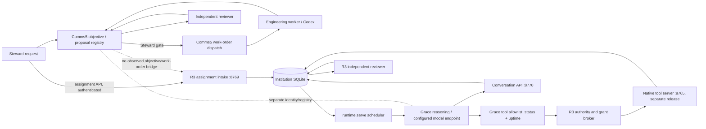

<!--
R3 CONTROLLED DOCUMENT
File: docs/audits/2026-11-05-riverview-core-autonomy-functional-audit.md
Component: AUDIT-GRACE-AUTONOMY
File Revision: 1.0.0
Created: 2026-11-06T00:41:22Z
Created By: Codex GPT-6, acting on Steward instruction
Purpose: Evidence-based functional assessment of Grace and Riverview institutional workflow
Execution Model: N/A; audit report
Observability: Sources, Git history, tests, issue coordination, and read-only local runtime probes documented in companion evidence file
Dependencies: Companion `evidence/2026-11-05-live-observations.md`; deployed release 8ab4b2ab1669b2bbc55467ec2cdd9bdc9f489135; repository history
Authority: Steward directive in Issue #41; inspection only; no production changes, deployments, grants, or institutional writes
Changed: 2026-11-06T00:41:22Z | RIVERVIEW-CORE-AUDIT-2026-11-05 | Codex GPT-6 | Initial report
Supersedes: None
Contracts: Project Charter Revision 2; Grace/R3 runtime, assignment, tool, verification, and Comms5 contracts described herein
Tests: N/A; audit did not modify or run the suite
History: New report; source provenance and historical implementation commits listed in report and evidence file
-->
# Riverview Core Autonomy Functional Audit

**Audit date:** 2026-11-05 (evidence collection continued through 2026-11-06 00:41 UTC)

**Repository baseline:** `1b96062dc40dec9a441854b3342d75303071b307`

**Observed deployed R3 release:** `8ab4b2ab1669b2bbc55467ec2cdd9bdc9f489135`
**Scope:** Grace autonomy and its institutional workflow dependencies. This report is an investigation, not an implementation proposal approved for execution.

## Executive summary

Riverview has working institutional components, and some have demonstrably processed real live work. The deployed R3 process can schedule Grace, accept an assigned activity, call a narrow set of authorized tools, persist messages and activity state, and hand evidence to a separate reviewer. A separate Comms5 workflow has also created and dispatched an engineering work order that reached independently accepted completion. These are meaningful assets; they do not add up to one connected autonomous workflow.

The main functional gap is at the seams. R3 assignment intake accepts a resident activity, not a proposal or approved institutional objective. Grace’s deployed model-visible tool allowlist contains only `r3.status` and `r3.host.uptime`; the live native tool catalog has more descriptors, but no proposal, objective, approval, work-order, or delegation operation. Comms5 has a separate Steward-gated proposal/work-order path, separate identities and records, and no observed bridge to the R3 assignment intake. The reviewer can evaluate submitted evidence, but an accepted activity is not the same thing as an accepted objective.

Continuation is partly real and durable, but not a demonstrated self-directed lifecycle. Live records show 24 completed and one failed resident-activity inbox item and ten accepted plus one inconclusive verification request. One inconclusive feedback delivery led to a single 270-event continuation chain. The next-step outputs repeat a small number of signatures, but evidence differs on every event; this establishes an unusually long correction chain, not proven non-progress. Current release health reports connected inference and execution based on registry/discovery state rather than a real model-inference or tool-invocation probe. The configured model endpoint itself responded to a read-only model-list request.

**Finding:** the deployed core is **partially operational but institutionally disconnected**. The evidence supports incremental repair of the workflow and contract seams while preserving working runtime, authority, scheduler, tools, and verification. Selective boundary reconstruction may be justified for durable objective/work state and versioned module contracts; a wholesale rebuild is not supported by this audit alone. This aligns with the separate architecture audit’s strategy of stabilizing the core and extracting selected boundaries.

The direct causes of the reported proposal and capability failures are supported at the R3 boundary. The exact cause of the V2 proposal-read denial and V2 zero-capability display remains unverified because the exact V2 request, identity, decision log, and registry response were unavailable. No production assignment or grant was created for this audit.

## Evidence labels and limits

- **Confirmed** means directly observed in repository history, source/configuration, a read-only live response, or durable record aggregates described in the companion evidence file.
- **Reported** means present in Issue #41 coordination or the Steward’s initial cases, but not independently reproduced by this audit.
- **Inference** is a conclusion drawn from confirmed evidence and is marked as such.
- **Unknown** means the required request, trace, or authority was not available. Unknowns are not treated as evidence of absence.

The 284-test result is reported by the integration handoff on Issue #41 for the deployed candidate and immutable release build. This audit did not rerun or modify tests. Its production checks were read-only; anonymous probes were used only to inspect public health and expected authorization boundaries.

## Functional audit matrix

| Capability | Expected behavior and authoritative requirement | Historical status | Current status | Failure boundary | Root cause (evidence / uncertainty) | Classification | Smallest viable correction | Priority |
|---|---|---|---|---|---|---|---|---|
| Grace autonomous execution loop | Charter Revision 2 expects residents to think, use authorized capabilities, communicate, verify, recover, and advance work without a Steward prescribing each next action. | Live 80B model selected and called a real `comms5_examples` tool in the Nov 2 milestone; a subsequent model completion failed HTTP 400. Later live host-status activity reached COMPLETED. This proves isolated inference/tool cycles, not broad autonomy. | **Degraded** | `runtime.serve` scheduler → inbox event → model/tool cycle → continuation/reviewer | Scheduler and model/tool paths exist, but supported activity types are narrow; health “inference connected” derives from resident registration, while tool “execution connected” derives from discovery, not live invocation. | Incomplete implementation; observability/configuration | Make health semantics match probes; define and acceptance-test an objective-level loop with stop, continue, blocker, and accepted-completion states. | Critical |
| Resident scheduling and lifecycle | Enabled residents should be instantiated and scheduled; lifecycle should support availability, activity, blocked/waiting, recovery, and completion. Charter Revision 2; `runtime.serve` and resident configuration. | Scheduler introduced in `7dfc0cc`; pending-restart recovery demonstrated in Nov 2 roadmap milestone. | **Degraded** | Runtime resident registry/config → scheduler | One configured R3 resident (`grace`) is scheduled. Reviewer is a service, not a resident. No other resident instances are configured. | Configuration; incomplete implementation | Load canonical residents from an authoritative registry and test scheduling/availability for each enabled resident. | High |
| Objective intake and reasoning | Steward requests should become durable objectives with ownership, intended outcome, constraints, and lineage; Grace should reason over them. Charter; Comms5 objective lifecycle. | Comms5 records show several real objective lifecycles; one completed. R3 assignment intake later added a distinct activity path. | **Broken across R3 boundary; separate Comms5 path works** | Steward/Comms5 objective registry → R3 assignment intake (no bridge observed) | R3 intake creates `RESIDENT_ACTIVITY`, not a proposal/objective, and accepts configured Grace only. Comms5 statuses are not dispatched into R3 in the inspected topology. | Architecture/interface gap | Add a versioned, authorized bridge that converts an approved objective to a durable R3 assignment with shared lineage/idempotency. | Critical |
| Proposal generation and persistence | Grace should independently draft requested proposal content, retain it durably, and report persistence/authority limits truthfully. Steward-gated Comms5 contract governs promotion. | No evidence that R3 Grace ever had a proposal-management tool or persisted a proposal. Comms5 proposal/seed operations are implemented in a different path. | **Absent in R3; partial in Comms5** | Grace model-visible capability allowlist → proposal registry/write API | Deployed Grace allowlist has only status and uptime; live R3 tool catalog has no proposal operation. A draft could be composed in chat, but the persisted proposal capability is absent. | Incomplete implementation / architecture | Separate drafting from persistence: let Grace return a draft and route durable submission through the existing Steward-gated proposal service with explicit result state. | Critical |
| Steward approval and authorization | Approval must be explicit, durable, identity-bound, and checked at each protected write/execution. Charter and Comms5 write-gate contracts; R3 authority/grant path. | Live Comms5 APIs expose Steward-gated promotion/work-order writes; R3 authority/tool audit shows real grants and denials. | **Working in components; not end-to-end connected** | Comms5 approval → work-order gate → R3 execution authority | R3 grants authorize individual native tools, not objective dispatch. Comms5 gates its own workflow. No shared approval-to-R3 assignment transition was observed. | Architecture/interface gap | Preserve current gates and bind approved objective identifiers/authority to the R3 dispatch bridge; do not infer or auto-grant. | Critical |
| Work-order creation and dispatch | Approved objectives should produce durable, idempotent work orders that reach an execution queue and report dispatch state. Comms5 contract and Engineering Foundry charter. | Oct 28 Comms5 objective demonstrably proposed/dispatched, executed by a Grace engineering worker, and independently accepted. Oct 29 work was rejected for rework; Nov 3 objective remained proposed with no assignment/dispatch. | **Partial** | Comms5 work-order service → worker/Codex queue; no R3 intake handoff | Comms5 can dispatch its own work order. The observed R3 assignment endpoint is a different interface; current Nov 3 proposal had zero dispatches. | Architecture/interface gap; incomplete implementation | Connect dispatch explicitly to the R3 assignment inbox or a defined worker queue, preserving idempotency and lifecycle status. | High |
| Tool and capability discovery | Grace should discover tools for her exact identity, receive descriptions/schemas, and see only capabilities available to her authority. Charter capability registry requirement; R3 tool-router contract. | Native tool server and router were introduced in `0a8f862`/`31650ac`; roadmap milestones record live calls. | **Degraded / inconsistent views** | Tool catalog (8765) → Grace configuration filter → V2 office view | Live catalog returned eight descriptors, while Grace’s filter exposed two. R3 audit records show status/uptime calls. V2’s reported zero-capability view belongs to a different runtime/identity. Tool server process comes from a different release family/source hash than unified runtime. | Configuration; architecture/provenance drift | Publish one identity-scoped capability contract per runtime and expose an authenticated diagnostic that explains discovered, filtered, denied, and callable states. | High |
| Authorized tool execution | A discovered capability should be invocable only with its exact principal, scope, and active grant; result/error is audited. R3 authority and native tool contracts. | Live audit aggregates include 303 successful status calls and 303 uptime calls, plus explicit denials for ungranted tools. Earlier live tool cycles also recorded. | **Working for narrow allowlist** | Grace principal → authority broker → native tool server | This narrow path is real. The external native-tools process is a separately versioned release with no Git metadata and a distinct code hash; deployment contract drift is confirmed, exact compatibility impact unresolved. | Configuration / deployment provenance | Pin and report tool-server artifact/source revision; add authenticated real invocation smoke for each allowed tool and fail closed on contract mismatch. | Medium |
| Engineering delegation | Grace should delegate an engineering objective to an available worker, track job state, and incorporate evidence. Charter Engineering Foundry; Comms5 work-order contract. | Oct 28 Comms5 work reached a real engineering worker and independent acceptance; Oct 29 rework was rejected. | **Partial, separate workflow** | Objective reasoning → Comms5 engineering work order/worker | Delegation works in Comms5 sample records, but no discovered R3 tool/API or objective bridge lets the deployed Grace loop create or track that work. | Architecture/interface gap | Reuse the existing Comms5 gated work-order operation through an explicit adapter and feed status/evidence to R3. | High |
| Independent verification | Completion claims should be checked by an independent reviewer against evidence and return accepted, rejected/rework, or inconclusive states. Charter and `runtime/verification.py`. | Reviewer added in `fc76a18`; live Comms5 and R3 examples include accepted and rejected/inconclusive outcomes. | **Working as a component; completion semantics disconnected** | Reviewer output → objective/work-order lifecycle | Live R3 has ten accepted and one inconclusive review. Activity COMPLETED means processing finished, not that objective was accepted. One inconclusive review produced a 270-event feedback continuation chain. | Incomplete integration / observability | Bind verification result to objective completion and require independent acceptance for success; cap/escalate repeated continuation with a durable blocker. | High |
| Durable state, continuation, recovery | Work, conversation, tool calls, blockers, evidence, and resume intent should survive restart and continue only when dependencies/authority allow. Charter; assignment/conversation persistence; Grace blocked-outcome work. | Durable conversations, event intake, restart recovery and continuation introduced across `7fb6031`, `cfdd032`, `96fc020`, `cd6b264`; restart recovery and real message persistence demonstrated in milestones. | **Degraded** | Inbox/review feedback → continuation scheduler → recovery/authorization route | SQLite contains durable activity and verification history; recovery helper is reported by integration as lacking a registered request route and not live-verified. No BLOCKED inbox status was present in the audit snapshot. Long feedback chain shows continuation can proceed without proving objective-level progress. | Incomplete implementation / interface | Register an authorized resume/escalate route, persist blocker dependencies, and test restart, authorization wait, resumption, and bounded escalation end-to-end. | Critical |
| Resident-to-resident communication | Residents should find peers, exchange requests/results under identity and authority, and coordinate durable work. Charter Revision 2. | Requirement is explicit; no live R3 multi-resident communication evidence found. | **Absent in deployed R3** | Resident registry/identity → communication broker | Runtime config has only Grace. Comms5’s “workers registered/enabled” are worker counts, not instantiated R3 residents. HR records have no authority-principal associations in the observed DB. | Configuration / incomplete implementation | Instantiate peers from canonical HR association/configuration and add authenticated, permission-tested message/coordination flows. | High |

## Historical regression analysis

### Demonstrated working behavior

Repository history and contemporaneous milestones show progressive implementation of a real but narrow runtime:

- `f495c7e` added supervision; `7dfc0cc` added the scheduler; `fba4815` added llama tool support; `4a5a352` and `0a8f862` added native tools; `31650ac` demonstrated an isolated real-HTTP tool cycle.
- `7fb6031` added assignment intake; `cfdd032` added conversation persistence; `fc76a18` added the independent reviewer; `96fc020` and `cd6b264` added objective/continuation work; `33f0edb` added authenticated routing.
- Nov 2 milestones document a real 80B tool request and durable assistant/tool-intent/tool-result records, followed by a model HTTP 400 on the next completion. The same-day roadmap records a live host-status activity completing and pending-restart recovery. Later events made real tool calls, but explicit two-stage instructions did not reliably produce continuation.
- The separate Comms5 history demonstrates one Oct 28 engineering job that was dispatched, executed, and accepted, plus an Oct 29 job rejected for rework. These are actual workflow outcomes, not proof that the R3 scheduler handles objectives.

### What changed and what did not

The current deployed R3 candidate `8ab4b2a` includes the Grace delivery at `1b96062`, but the deployed configuration still limits Grace to two native tools and one resident. The core recovery helper’s presence is not equivalent to an exposed/authorized recovery interface; the integration coordination report says no website recovery endpoint is registered and live recovery is unverified. The separately running native tool server is not built from the unified release tree and has no verifiable Git revision, creating provenance/contract uncertainty.

No historical evidence located in this audit shows an R3 proposal-manager tool, proposal persistence for Grace, or R3 objective-to-Comms5 work-order bridge. Therefore the simple proposal failure should be classified as a missing integration/feature, not a proven regression. Likewise, V2’s empty registry and inability to retrieve a listed proposal remain unlocalized because the exact V2 request and authorization trace were unavailable. The discrepancy is consistent with distinct runtime/identity/registry boundaries, but the precise denial point is unresolved.

## Runtime and dependency map

The diagrams combine source/configuration and observed process topology. A configured edge is not proof that a request crossed it. The dashed boundaries are the key missing interfaces.

## Ranked root-cause findings

1. **No connected institutional lifecycle between proposal/objective and Grace assignment (critical).** Comms5 can gate and dispatch work; R3 can accept resident activities; no observed contract carries approved objective ID, authority, evidence criteria, and idempotency across the boundary. This prevents end-to-end objective execution.
2. **Grace has no proposal capability and too narrow a runtime allowlist (critical/high).** The deployed Grace filter exposes status and uptime only; neither the full catalog nor R3 runtime includes a proposal lifecycle tool. This explains why Grace cannot persist the clock proposal. Drafting text remains possible in principle, but her reported all-or-nothing `blocked` response indicates an additional reasoning/prompt behavior gap.
3. **Completion and continuation statuses do not represent institutional success (high).** Activity processing is recorded as COMPLETED independently of reviewer acceptance. A 270-event chain from one INCONCLUSIVE review with repeated next-step signatures is a risk signal; unique evidence hashes prevent concluding it was futile. There is no demonstrated bounded escalation/resume contract.
4. **Identity, registry, and deployment provenance diverge across runtime families (high).** V2 `office:grace`, Comms5 office actor IDs, and R3 `resident:Grace` are not shown to share an authoritative mapping. The active native tools process comes from a separate release tree. Exact effect on V2 access remains unknown.
5. **Only one R3 resident is instantiated (high).** Peer communication and delegation cannot be demonstrated when the runtime config has only Grace. Comms5 worker counts do not change this.
6. **Health signals overstate end-to-end readiness (medium).** Runtime health derives inference/execution-connected flags from registration and tool discovery. These do not test model inference or an authorized tool invocation. A separate model-list probe proves endpoint availability only, not successful generation.

## Missing end-to-end acceptance coverage

Existing 284 passing integration tests (per Issue #41) can coexist with failures because they largely exercise isolated components using temporary stores, fake models, local test HTTP servers, and test clients. “Integration” here means several components are connected in a controlled test process; it does not mean production identities, configuration, databases, grants, release artifacts, or real external model calls were used. Examples include the conversation runtime test’s fake endpoint and temporary DB, native integration’s local fake model/tool servers, and FastAPI tests with temporary stores.

The following acceptance cases are not evidenced by the suite/release record:

1. Steward request → proposal draft → persisted proposal visible to authorized V2 and Grace readers, with unauthorized reads denied and diagnosable.
2. Capability discovery under the exact deployed identity: catalog, identity mapping, grant decision, filtered model schema, invocation, and audited result all agree.
3. Approved Comms5 objective → exactly one R3 activity/work order with preserved objective lineage, authority, and acceptance criteria.
4. Real deployed model generation on an assigned objective, authorized tool invocation, durable evidence, and independent reviewer acceptance before objective completion.
5. Denied tool/approval request becomes a durable blocker, requests appropriate Steward action, receives authorization, and resumes without replaying completed side effects.
6. Restart while queued, reasoning, waiting for authorization, and awaiting reviewer; verify idempotent recovery and no duplicate dispatch.
7. Rejected and inconclusive review produce bounded rework/escalation, including a maximum continuation policy and human-visible progress evidence.
8. Multi-resident registry/availability and resident-to-resident message, delegation, permission-denial, and recovery workflows.
9. Release-manifest check verifies exact website, institution, model endpoint, native tool server, DB schema, config, and registry versions in the live topology.
10. Health endpoint reports separate last-success timestamps for model inference, capability discovery, authorized invocation, reviewer, database, and dispatch bridge.

## Recommended recovery sequence

1. **Make status truthful and observable.** Add non-sensitive diagnostics that distinguish configured, reachable, discovered, authorized, invoked, and independently verified. Pin runtime and native-tool artifact provenance.
2. **Close the objective-to-assignment seam.** Define the smallest versioned bridge from the existing Steward-gated Comms5 work order to R3 intake. Preserve identity, objective lineage, constraints, evidence criteria, authority, and idempotency. Do not broaden grants implicitly.
3. **Make proposal drafting useful before persistence.** Allow Grace to draft and return content when no write capability exists; route persistence through explicit Steward-gated proposal operations and return a precise blocked-on-authorization state instead of discarding the drafting step.
4. **Bind reviewer results to lifecycle state.** Require accepted verification for objective completion; bound repeated inconclusive/rework continuation and surface blockers/escalation durably.
5. **Expose recovery as a real contract.** Register and authorize a resume/escalate operation; test dependency satisfaction, grant changes, restart recovery, and idempotency.
6. **Reconcile identity/registry contracts.** Use HR’s explicit confidential authority-principal association as the mapping source when available; fail closed when absent. Diagnose V2 proposal read and registry state from exact request traces before changing policy.
7. **Add resident peers and delegation only after the single-resident lifecycle passes end-to-end acceptance.** Validate availability and communication with distinct principals and least authority.
8. **Run isolated end-to-end acceptance against a production-like immutable release**, then separately plan any controlled deployment. This report authorizes no deployment.

## Incremental repair versus reconstruction

The audit does **not** justify replacing the entire institutional core. Live evidence shows working scheduler, durable SQLite history, authenticated assignment/conversation boundaries, narrow granted tools, a reachable model endpoint, independent verification, and a separate successful engineering work-order path. Rebuilding those would discard proven behavior and raise migration risk.

Incremental repair is viable for connecting objective dispatch, improving proposal handling, aligning identity/registry contracts, correcting lifecycle semantics, and making recovery observable. Selective architectural reconstruction is justified where a durable objective/work entity and versioned adapters are missing: these should be explicit module contracts rather than implicit imports or mismatched database assumptions. The separate architecture audit recommends the same core-stabilization/selective-extraction strategy. That recommendation should be revisited only if an end-to-end acceptance implementation demonstrates that these seams cannot be repaired while preserving the existing authority and runtime assets.

## Unresolved items

- Exact V2 proposal-read request, principal, registry, authorization decision, and logs are needed to identify why a listed proposal is not retrievable.
- Exact V2 capability query/runtime endpoint and the identity used to query `office:grace` are needed to pinpoint the reported zero-capability result.
- The public website hostname/path returned 404 for the two attempted health URLs; the correct external route was not confirmed. Local candidate website health on port 8303 returned 200.
- The 270-event feedback chain has four next-step signatures and 270 distinct evidence signatures. Without reviewing protected task content or a complete semantic evaluator trace, progress quality cannot be determined from hashes alone.
- No evidence here establishes current HR-backed canonical-to-runtime resident mappings; the read-only HR snapshot contained zero explicit authority-principal associations.

## Companion evidence

See [`evidence/2026-11-05-live-observations.md`](evidence/2026-11-05-live-observations.md) for the read-only probe scope, counts, artifact provenance, and non-sensitive historical references.
